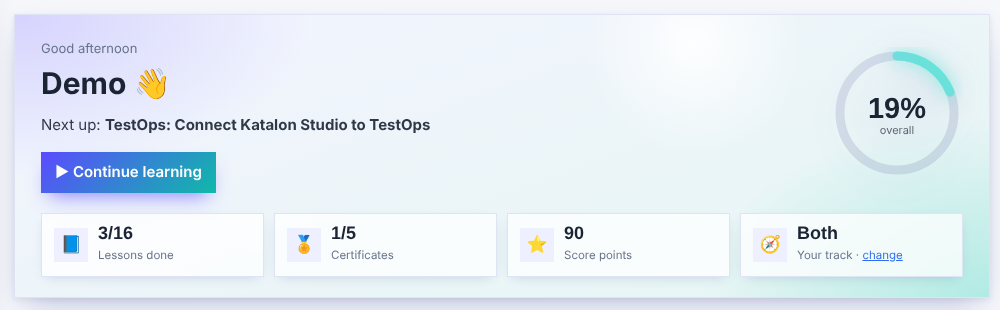
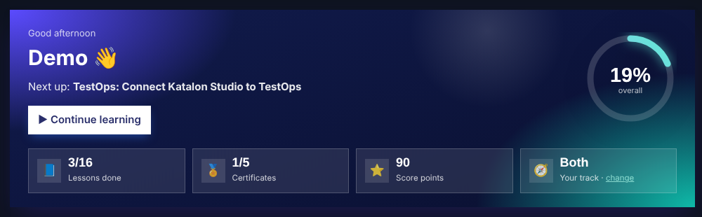

# KT Academy

A learning and certification portal that helps manual testers move into test automation with Katalon. Trainees follow short lessons, submit work for review, earn certificates and track their progress. Admins review submissions and watch the academy grow.

**Live demo:** https://autotechteam-kt-academy.netlify.app




## Features

**Trainees**
- 16 step-by-step lessons (Local Katalon, TestOps, Tools)
- 5 certification paths with guided modules
- Work submission with Google Drive links, review and score
- Progress ring, score points, journey map and Top 5 leaderboard
- Dark and light themes, responsive on phone and desktop

**Admins**
- Review queue: approve or return submissions with feedback
- Trainees page with progress and certificates
- Academy growth graph, progress by tribe, training status

## Tech

| Part | Choice |
|---|---|
| Front end | Single-file HTML, CSS and vanilla JavaScript (hash router) |
| Back end | Supabase: Postgres, row-level security, auth, storage |
| Sign-in | Email and password, Google, GitHub |
| Hosting | Netlify (static) |

## Run it locally

```bash
python3 -m http.server 3000
# open http://localhost:3000
```

Create a free Supabase project, run the SQL files in `supabase/` (start with `supabase-setup.sql`), then put your project URL and public anon key in `index.html`. Never put a `service_role` key in the front end.

## Repository layout

```
index.html        the app
supabase/         database setup and migration scripts
docs/             project summary (PDF) and automation test cases (XLSX)
```

## Roadmap

- [ ] Convert to Next.js + TypeScript + Tailwind
- [ ] Add `data-testid` locators to every page element
- [ ] Playwright end-to-end tests (see `docs/KT_Academy_Test_Cases.xlsx`)
- [ ] GitHub Actions: lint, test, deploy
- [ ] Test results dashboard for the Katalon framework (web, API, mobile)

## Documentation

- [Project summary (PDF)](docs/KT_Academy_Project_Summary.pdf)
- [Automation test cases (XLSX)](docs/KT_Academy_Test_Cases.xlsx)
